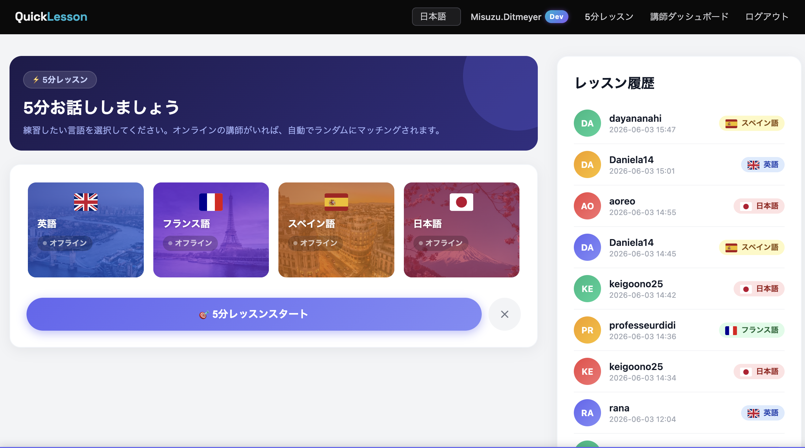
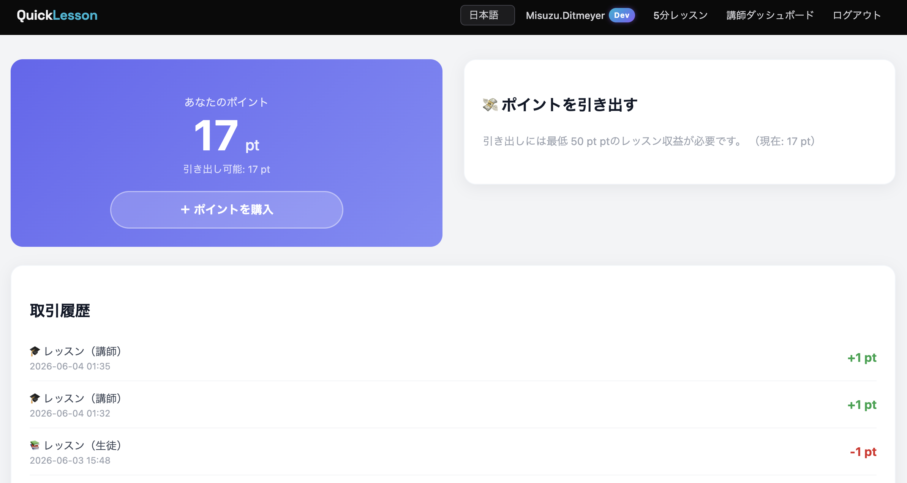

# QuickLesson

A web application that makes language speaking practice simple through short, real-time conversations with native speakers.

🌐 Live Demo: https://django-5min-languageapp.onrender.com/
📄 Status: Active Development

---

## Overview

QuickLesson is a language exchange platform designed for learners who want to improve their speaking skills without committing to long lessons.

Instead of one-hour sessions, users join 5-minute conversations with native speakers whenever they have time.

---

## Features

- 🌍 Multiple languages (Japanese, English, Spanish, French)
- 🎥 Real-time video calls
- 👩‍🏫 Native speaker matching
- ⭐ Tutor ratings
- 📖 Session history
- 👤 User profiles
- 📱 Responsive design

---

## Tech Stack

### Backend
- Django
- Django REST Framework
- PostgreSQL

### Frontend
- HTML
- CSS
- JavaScript

### Deployment
- Render

---

## Screenshots

| Home | point |
|------|------------|
|  |  |

---

## Project Structure

```
quicklesson/
├── accounts/
├── lessons/
├── tutors/
├── chat/
├── static/
├── templates/
└── manage.py
```

---

## Installation

```bash
git clone ...
cd quicklesson
pip install -r requirements.txt
python manage.py migrate
python manage.py runserver
```

---

## Roadmap

- [x] Authentication
- [x] Video calls
- [x] Tutor dashboard
- [ ] AI feedback
- [ ] Mobile app
- [ ] Push notifications

---

## About the Project

QuickLesson is a personal project that I continue to develop while collecting feedback from real users.

The goal is to make language speaking practice accessible, flexible, and enjoyable through short conversations.

## Next-conversation questions

After a tutor saves a note, the server generates five questions using OpenAI's
Responses API (`gpt-4.1-mini` by default). Only the same student's latest five
notes in the lesson language are included. The current CEFR level, or the latest
specified level in that history, controls difficulty. No account names or emails
are added to the request. Note text itself is sent to OpenAI; `store` is false.

Questions are saved on the note and shown below the tutor guide in the next
lesson. Opening the room never generates questions. Repeated submissions for the
same match reuse the first saved note and do not generate again. API failures,
missing keys, or missing levels leave the note saved without suggestions; no
automatic retry is performed. A save may wait up to the HTTP timeout (8 seconds).

Local development reads `OPENAI_API_KEY` from the ignored `.env.local` file if
it is not already in the environment. Production requires `OPENAI_API_KEY` in the
hosting service's secret environment settings. Never commit the env file or key.
`OPENAI_QUESTION_MODEL` may override the model. Run `python manage.py migrate`
after deployment to add the question fields (the existing build script does this).
Existing notes are not automatically sent to the API or backfilled.

## Gold AI Study Notes

The home page and both student history views link to `/study-notes/`.
Active Gold membership is checked on every generation POST, including direct requests.
There is no monthly or lifetime quota and no point debit or additional user fee.
Saved sheets remain readable by their owner after Gold expires; generation requires renewal.

Configuration (existing `OPENAI_API_KEY` is reused; never commit its value):

| Environment variable | Default | Purpose |
| --- | --- | --- |
| `OPENAI_API_KEY` | Existing server secret | OpenAI credential |
| `OPENAI_STUDY_MODEL` | `gpt-4.1-mini` | Responses API model supporting strict structured output |
| `OPENAI_STUDY_MAX_OUTPUT_TOKENS` | `3600` | Output ceiling (clamped to 1000–6000) |
| `OPENAI_STUDY_TIMEOUT_SECONDS` | `20` | HTTP timeout (clamped to 1–20 seconds) |

Deploy with the existing build script (`migrate`, `collectstatic`, `compilemessages`).
For local setup run `python manage.py migrate`. Migration `0026_study_notes` adds only
`core_studynote` and its constraints; no existing lesson or note data is rewritten.
The web worker/proxy timeout should exceed the API timeout with room for DB/render work
(at least 30 seconds). No background worker or extra Python package is required.

The latest five completed lessons **in the selected target language** are selected, excluding
interviews and other learners. The newest applicable tutor note per lesson provides its level,
conversation content (including legacy notes), and next-conversation comments. Unknown level
uses simple beginner material without pretending the learner was assessed.
Private notes default OFF and are omitted from the request unless explicitly selected.
Only relevant text and language/level are sent: no account IDs, timestamps, profile records,
usernames or email fields. Known account identifiers, labelled names, emails, links and phone
patterns in free text are masked, but automatic masking is not a complete PII guarantee;
the UI asks learners to remove sensitive information. Original input text is not duplicated
in the new table. Source lesson IDs, consent, language pair and level are retained locally.
`store: false` is sent to OpenAI; this is not a promise of zero provider retention.
The UI links to OpenAI's data-handling policy. No recording/monitoring is introduced.

The API returns strict JSON, which is checked again locally and rendered with Django
escaping (never `safe` or generated HTML). Corrections require an exact evidence quote
from a tutor note, the original phrase within that quote, and an explicit error/correction
marker in a supported language. Unsubstantiated corrections are discarded; ambiguous
records may therefore be omitted. The prompt also prohibits inferring mistakes. Review
plans must total 10–15 minutes. Inputs are capped at five lessons and 1000 characters per
field, with a hard 24,000-byte ceiling for the entire API payload (including schema and
instructions), giving a conservative input-token bound; output tokens are capped separately.

A conditional unique database constraint permits only one active generation per user
across workers/tabs/languages. Signed per-form request keys prevent replay, including
failed requests. The UI disables repeated submission. Failed jobs release the claim;
abandoned jobs expire after five minutes on the next submission. No automatic paid retry
occurs. Refresh after a network interruption to find a completed sheet in the saved list.

The `core.services.study_notes` logger records model, completion status, and input/output
token usage, never prompts, completions or credentials. Successful usage is also stored
on the sheet; incomplete responses log available usage without saving an incomplete sheet.
HTTP errors without usage metadata log only a generic failure.

Validation:
`python manage.py test core.tests.test_study_notes core.tests.test_private_notes core.tests.test_signup_login`
The tests mock OpenAI, including timeouts/refusals, so they use no API credits or student data.
A separate synthetic Japanese/French live request was successfully validated during implementation.

Implementation references: [Structured Outputs](https://developers.openai.com/api/docs/guides/structured-outputs?api-mode=responses) and [GPT-4.1 mini](https://developers.openai.com/api/docs/models/gpt-4.1-mini).
